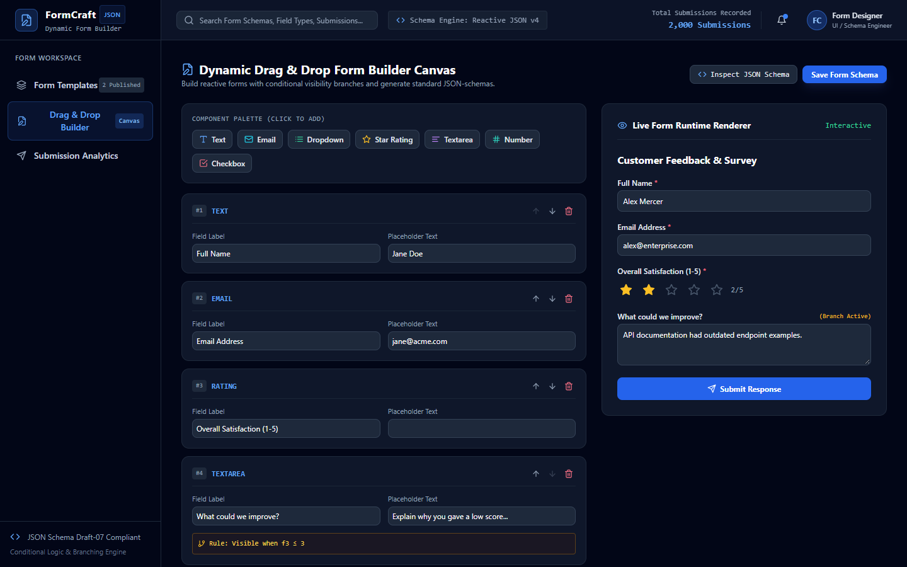
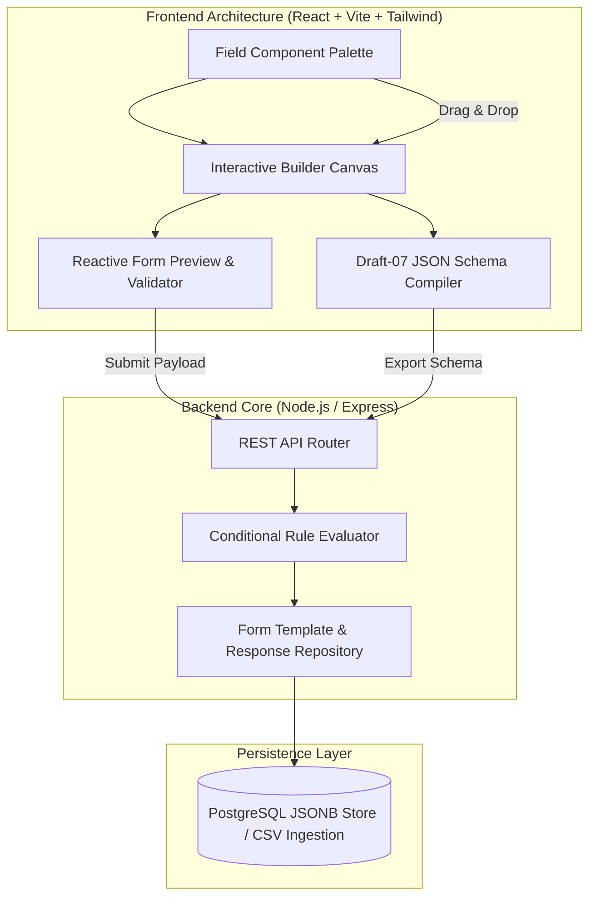

<div align="center">

# FormCraft — Dynamic Drag-and-Drop Visual Form Engine & Schema Compiler

[](LICENSE)
[](https://reactjs.org/)
[](https://vitejs.dev/)
[](https://nodejs.org/)
[](https://json-schema.org/)
[](https://docker.com)

**Enterprise-grade visual form designer, real-time reactive canvas, conditional branching logic evaluator, and JSON Schema Draft-07 compiler for data collection at scale.**

[Architecture](#system-architecture) • [Live Dashboard](#live-dashboard-preview) • [Benchmark Data](#benchmark-dataset) • [API Reference](#rest-api-documentation) • [Quickstart](#quickstart-guide)

</div>

---

## Live Dashboard Preview

<div align="center">
  
</div>

---

## Core Capabilities

- **Drag-and-Drop Form Canvas:** Intuitive low-code builder allowing product teams and engineers to compose multi-step forms, surveys, and complex intake workflows.
- **Conditional Branching Engine:** Declarative logic evaluator (`dependsOn`, `operator: lessThanOrEqual / equals`, `value`) dynamically revealing or concealing questions in real-time based on respondent interactions.
- **Bi-directional JSON Schema Draft-07:** Real-time bi-directional synchronization between the visual canvas and standardized JSON Schema specifications.
- **Payload Inspector & Audit Trail:** Structured JSONB ingestion stream with timestamped submissions, completion latency metrics, and verification status badges.
- **Enterprise Palette:** Supports short text, paragraph textarea, dropdown select, numeric rating scales, multi-choice radio groups, file attachments, and date pickers.

---

## System Architecture



---

## Benchmark Dataset

FormCraft includes enterprise benchmark datasets located in [`data/kaggle_formcraft_schema_benchmark.csv`](data/kaggle_formcraft_schema_benchmark.csv) simulating corporate intake, CSAT surveys, SOC2 compliance audits, and patient medical intake records.

| Form ID | Title | Category | Status | Submissions | Avg Completion Rate |
| :--- | :--- | :--- | :--- | :--- | :--- |
| `FORM-101` | Customer CSAT & Product Feedback Survey | Customer Experience | `PUBLISHED` | 1,420 | 84.5% |
| `FORM-102` | Employee Equipment & Hardware Requisition | Internal IT Operations | `PUBLISHED` | 580 | 92.0% |
| `FORM-103` | Enterprise Vendor Risk Assessment (SOC2) | Security & Compliance | `DRAFT` | 0 | 0.0% |
| `FORM-104` | Patient Medical Intake & Consent | Healthcare & Clinical | `PUBLISHED` | 850 | 91.8% |

---

## REST API Documentation

### 1. Retrieve Form Templates
```http
GET /api/v1/forms
```
**Response:**
```json
[
  {
    "id": "FORM-101",
    "title": "Customer CSAT & Product Feedback Survey",
    "category": "Customer Experience",
    "status": "PUBLISHED",
    "submissionsCount": 1420,
    "completionRatePct": 84.5,
    "schema": {
      "title": "Customer CSAT & Product Feedback",
      "fields": [
        { "id": "f1", "type": "text", "label": "Full Name", "required": true }
      ]
    }
  }
]
```

### 2. Submit Form Response
```http
POST /api/v1/forms/:id/submit
Content-Type: application/json

{
  "fullName": "Sarah Connor",
  "workEmail": "sarah.connor@cyberdyne.io",
  "rating": 5,
  "feedbackNotes": "Exceptional responsiveness and dynamic schema generation."
}
```

---

## Quickstart Guide

### Prerequisites
- Node.js 18+ or Docker & Docker Compose
- Git

### Running Locally with Node.js

```bash
# Clone repository
git clone https://github.com/Prasunnandi/formcraft-drag-drop-builder.git
cd formcraft-drag-drop-builder

# Install and start backend
cd backend
npm install
npm start &

# Install and start frontend
cd ../frontend
npm install
npm run dev
```

### Running with Docker Compose

```bash
docker-compose up --build
```
Navigate to `http://localhost:3000` to access the interactive FormCraft visual builder.

---

## License

Distributed under the MIT License. See `LICENSE` for more information.
